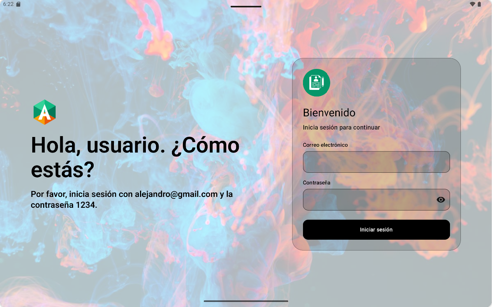
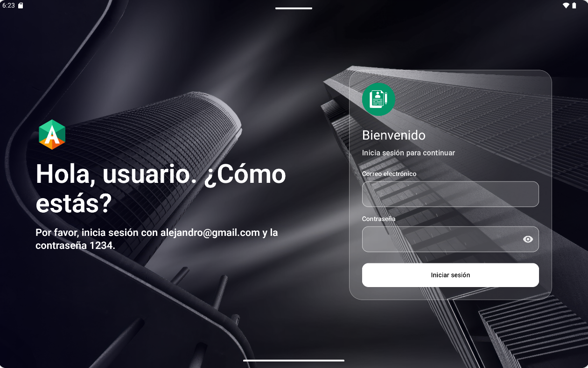

# Login_compose

App Android de ejemplo con **Jetpack Compose** y **Material 3**: una pantalla de login y otra de bienvenida, adaptables a móvil y tablet, en modo claro y oscuro. Me apoyé en Figma como base para tener las ideas claras antes de programar.

| Modo claro | Modo oscuro |
|:---:|:---:|
|  |  |

## Decisiones de diseño

- Tarjeta translúcida sobre el fondo: en la app va sobre una foto con un velo para que se lea el texto.
- Logo circular verde con candado: cerrado en el login, abierto en la bienvenida.
- Fuegos artificiales dibujados con `Canvas` como ilustración de la bienvenida.
- Botón «Cerrar sesión» abajo y centrado.

## Extras implementados

- **Animación al iniciar sesión:** `AnimatedContent` en `MainActivity.kt`: el login se desvanece y la bienvenida entra con fundido, deslizamiento lateral y zoom; al cerrar sesión entra el login desde el otro lado. El fondo con foto queda fijo para que se note el cambio. Además, los fuegos artificiales crecen desde el centro con un `Animatable`.
- Modo claro y oscuro.
- Adaptación a móvil y tablet (`BoxWithConstraints`).
- Componentes reutilizables: `LogoCircular`, `CampoTexto`, `FondoPantalla`.
- Ilustración propia con `Canvas`.

## Qué hace el código

- `MainActivity.kt`: un único estado (el nombre del usuario) decide qué pantalla se ve, sin librería de navegación; `AnimatedContent` anima el cambio.
- `ui/LoginScreen.kt`: formulario con validación, botón para mostrar/ocultar la contraseña y mensaje de error. El diseño cambia entre móvil y tablet con `BoxWithConstraints`.
- `ui/WelcomeScreen.kt`: bienvenida con el nombre del usuario y unos fuegos artificiales dibujados con `Canvas` que se animan al aparecer.
- `ui/LogoCircular.kt`: logo reutilizable en ambas pantallas.
- `ui/theme/`: colores, tipografía y tema Material 3 (claro/oscuro).

**Datos de prueba:** `alejandro@gmail.com` / `1234`

## Cómo ejecutarlo

Abre el proyecto en Android Studio y pulsa **Run**, o desde la terminal: `./gradlew installDebug` (Android 8.0 / API 26 o superior).

Kotlin · Jetpack Compose · Material 3
